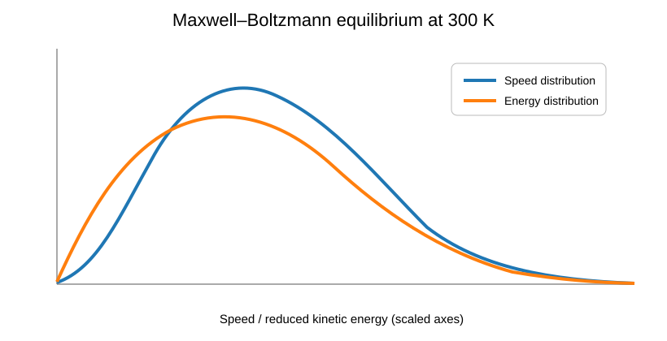
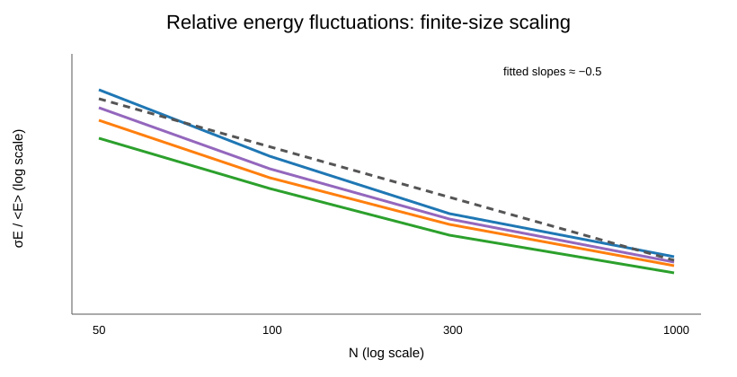

# Monte Carlo & Statistical Physics

Computational statistical-physics projects covering a hard-sphere gas with thermostatting and a separate three-level Metropolis model.

| Canonical distributions at 300 K | Finite-size fluctuation scaling |
|---|---|
|  |  |

## 1. Hard-sphere gas

Starting from the VPython `HardSphereGas` demonstration, the model was extended and analysed for **500 particles**. The coursework modifications include:

- robust non-overlapping particle initialisation and collision handling
- an **Andersen thermostat** at **T = 300 K**
- comparison of simulated speed and kinetic-energy distributions with Maxwell–Boltzmann theory
- comparison of weak and strong bath-coupling frequencies
- an external gravitational field and tests of the expected vertical-velocity and barometric position distributions

### Source files

- [`hard_sphere_q1_radius_study.py`](hard_sphere_q1_radius_study.py) — numerical stability and effective-radius study
- [`hard_sphere_q2_andersen_thermostat.py`](hard_sphere_q2_andersen_thermostat.py) — canonical-ensemble dynamics with an Andersen thermostat
- [`hard_sphere_q3_gravity.py`](hard_sphere_q3_gravity.py) — thermostat plus gravitational field

The submitted analysis uses the Andersen collision probability

`P(bath collision in Δt) = 1 - exp(-νΔt)`,

with momentum components resampled from the Maxwell–Boltzmann distribution at the bath temperature.

## 2. Three-level Metropolis model

A second Monte Carlo model simulates **N independent particles in three energy levels** using Metropolis updates. The main study uses **N = 1,000**, **120,000 Metropolis steps**, a **20,000-step burn-in**, and sampling every **50 steps**.

The simulation compares equilibrium populations with Boltzmann theory and tests the finite-size scaling

`σ_E / <E> ∝ N^(-1/2)`.

Across the reported temperature cases, fitted slopes are close to the theoretical value `-0.5`, with high `R²` values.

### Reproducible companion

- [`python/three_level_metropolis.py`](python/three_level_metropolis.py)
- [`python/three_level_metropolis.ipynb`](python/three_level_metropolis.ipynb)
- [`report/README.md`](report/README.md) — provenance and description of the privacy-cleaned PDF portfolio edition

## Tools

Python, NumPy, Matplotlib, VPython, Monte Carlo / Metropolis sampling and statistical mechanics

## Attribution and provenance

The hard-sphere implementation is based on the VPython demonstration by **Bruce Sherwood** and was substantially modified for the coursework. The submitted report originated as collaborative coursework; collaborator names and student identifiers are omitted from this public portfolio edition for privacy. Repository curation, the reproducible companion notebook and portfolio visualisations are maintained by **Adrià Saz Guerra**.
